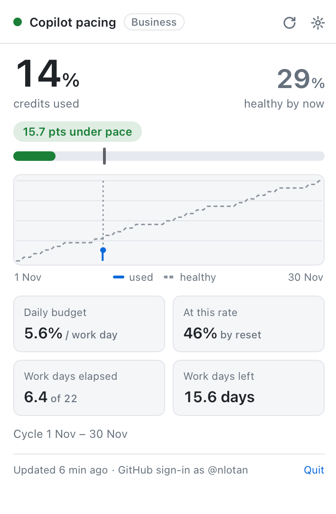
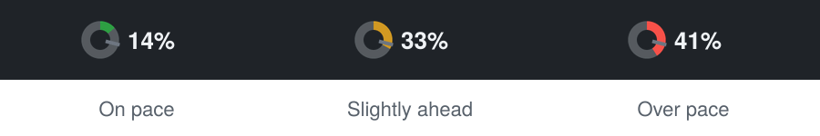
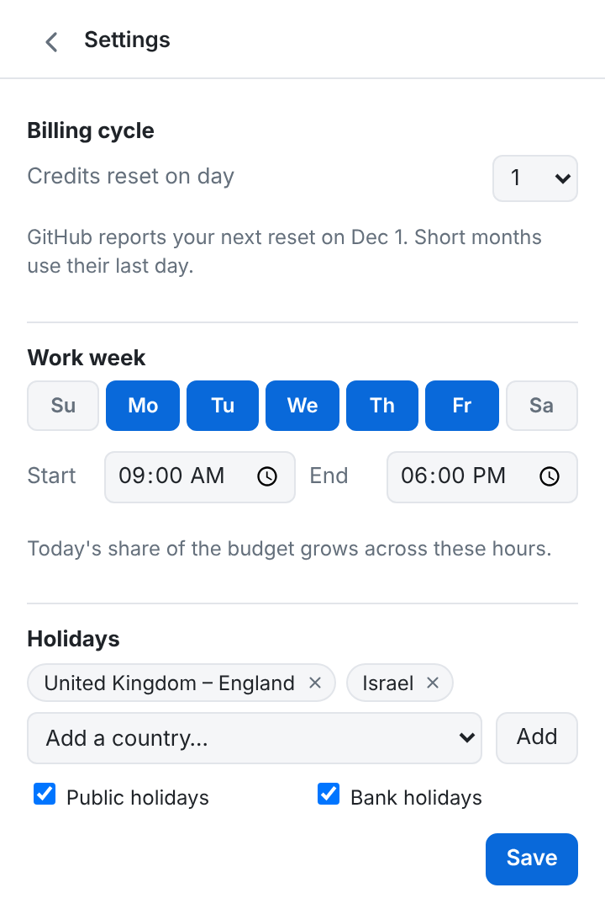

<h1 align="center">Copilot Pacer</h1>

<p align="center">
  <b>Know if your GitHub Copilot credits will last the month, at a glance.</b><br>
  A tiny menu-bar (macOS) and system-tray (Windows) app that compares how much
  Copilot you've used with how much you <i>should</i> have used by now,
  counting only your working days.
</p>

<p align="center">
  <a href="https://github.com/nirlotan/copilot-pacer/releases/latest/download/Copilot-Pacer-macOS.dmg"><b>⬇ Download for macOS</b></a>
  &nbsp;·&nbsp;
  <a href="https://github.com/nirlotan/copilot-pacer/releases/latest/download/Copilot-Pacer-Windows-Setup.exe"><b>⬇ Download for Windows</b></a>
  &nbsp;·&nbsp;
  <a href="https://github.com/nirlotan/copilot-pacer/releases/latest">All downloads</a>
</p>

<p align="center">
  <a href="https://github.com/nirlotan/copilot-pacer/releases/latest"></a>
  <a href="https://github.com/nirlotan/copilot-pacer/actions/workflows/build.yml"></a>
  
</p>

<p align="center">
  
</p>

---

## Why

The Copilot extension tells you that you've used **14%** of your credits.
It doesn't tell you whether that's a lot.

On the 9th of the month it's fine. On the 27th, after a week off, it's a
different story. Copilot Pacer works out a **healthy usage line** for the
billing cycle that ignores weekends, public holidays and your days off, then
shows whether you're ahead of it or behind it. You won't run dry before the
reset, and you won't leave half your credits unused either.

## Features



- **One glance in the menu bar.** A ring fills up with your usage and turns
  **green**, **amber** or **red** depending on your pace. A small tick marks
  where you should be today. On macOS your % sits right next to it.
- **Click for the full picture:** % used vs. % healthy, how far ahead or
  behind you are, and a chart of your usage against the healthy line for the
  whole cycle.
- **A daily budget:** "5.6% per work day" tells you how much you can use
  for the rest of the cycle and still make it.
- **A forecast:** "46% by reset" shows where you'll land at your current rate.
- **Counts working days only:**
  - choose your work week (Mon–Fri, Sun–Thu, anything) and working hours;
  - add **public holidays for 200+ countries and regions** (built in, works
    offline) plus your own days off;
  - today counts in proportion to your working hours elapsed.
- **A heads-up when you're over pace:** a notification at most once a day,
  with a tolerance you choose.
- **Your billing cycle:** credits reset on the 1st by default. Pick any day
  if your plan differs.
- **Works on corporate networks.** It finds your proxy automatically,
  including PAC/WPAD auto-config files, or you can enter one yourself.
- **Starts with your computer, if you want it to.** Turn on *Launch at login*
  from the tray menu or Settings. The app lives in the menu bar / system tray,
  and you choose whether it also shows in the Dock (macOS) or taskbar (Windows).
- **Keeps itself up to date.** Copilot Pacer checks GitHub for new releases
  daily (or on demand: *Check for updates…* in the tray menu). It downloads the
  new installer to your Downloads folder and offers a one-click **Install**.
- **Light and dark mode** and a tiny footprint: a native app, not Electron,
  with a 5 MB download on macOS and 2 MB on Windows.

<br clear="right">

## Download & install

| Platform | Download | Notes |
| --- | --- | --- |
| **macOS** 10.15+ (Apple Silicon & Intel) | [Copilot-Pacer-macOS.dmg](https://github.com/nirlotan/copilot-pacer/releases/latest/download/Copilot-Pacer-macOS.dmg) | Universal app |
| **Windows** 10/11 (x64) | [Copilot-Pacer-Windows-Setup.exe](https://github.com/nirlotan/copilot-pacer/releases/latest/download/Copilot-Pacer-Windows-Setup.exe) | Recommended installer |
| Windows (MSI, for managed deployment) | [Copilot-Pacer-Windows.msi](https://github.com/nirlotan/copilot-pacer/releases/latest/download/Copilot-Pacer-Windows.msi) | |

Older versions and release notes are on the [Releases page](https://github.com/nirlotan/copilot-pacer/releases).

### macOS

1. Open `Copilot-Pacer-macOS.dmg` and drag **Copilot Pacer** into **Applications**.
2. Launch it. A ring appears in the menu bar; there's no Dock icon.
3. If macOS says the app "can't be opened" or "is damaged" (builds that
   aren't notarized yet), run this once in Terminal:
   ```sh
   xattr -cr "/Applications/Copilot Pacer.app"
   ```
   Or right-click the app → **Open** → **Open**.

### Windows

1. Run `Copilot-Pacer-Windows-Setup.exe`.
2. If SmartScreen shows "Windows protected your PC", click **More info →
   Run anyway**.
3. The ring appears in the system tray. If it's hidden, click the **^** arrow
   and drag the icon onto the taskbar to keep it visible.

## Getting started

1. **Click the tray icon** and choose **Sign in with GitHub**. Your browser
   opens GitHub's device page and the code is copied for you. Paste it and
   approve.
   > 💡 GitHub signs in **whichever account your browser is logged into**.
   > Check the "Signed in as …" line on that page. If it's the wrong
   > account, sign out on github.com first or open the link in a private
   > window.

   Already use the [GitHub CLI](https://cli.github.com)? If you're logged in
   with `gh`, Copilot Pacer picks that up automatically and you can skip this.
2. **Open Settings (⚙)** and set your work week, working hours, holiday
   countries and any days off. Israeli time zones start with a Sun–Thu week
   and Israeli holidays; everyone else starts with Mon–Fri.
3. That's it. Usage refreshes every 10 minutes (configurable), and the
   healthy line moves every minute.

<p align="center">
  
</p>

## How the healthy line works

Each working day in your cycle gets an equal slice of 100%. Weekends,
holidays and days off get nothing, so the line stays flat across them.
Today's slice fills up gradually during your working hours.

```
healthy % = working days elapsed (incl. part of today) ÷ working days in cycle × 100
daily budget = (100 − used %) ÷ working days left
```

| Colour | Meaning |
| --- | --- |
| 🟢 Green | At or below the healthy line |
| 🟠 Amber | Above it, but within your tolerance (default 5 points) |
| 🔴 Red | Above it by more than your tolerance (you'll get a notification) |

## Corporate networks & proxies

Behind a company proxy? By default (**Settings → Network → Automatic**),
Copilot Pacer finds your proxy the way your OS does, including PAC/WPAD
auto-config files on both macOS and Windows. It also falls back to the
`HTTPS_PROXY` set in your shell. **Settings → Network** shows which proxy it's
using and where that came from. You can also enter one manually
(`http://`, `https://` or `socks5://`) or turn the proxy off.

If your organisation uses SAML single sign-on, GitHub may ask you to
authorise the sign-in for your organisation.

## Privacy

- Copilot Pacer talks **only to GitHub**: the same usage endpoint the
  Copilot editor extensions use, plus GitHub sign-in.
- Your token stays in the **macOS Keychain / Windows Credential Manager**.
- Settings and a small usage history stay on your computer. No analytics,
  no telemetry, no servers of ours.

## FAQ

**It's showing the wrong GitHub account.**
Copilot Pacer prefers an account added with *Sign in with GitHub*. Otherwise
it uses the active GitHub CLI account. Go to Settings → Account → **Sign in
with GitHub instead** and approve the sign-in in a browser logged into the
right account. Or run `gh auth switch -u <user>` and restart the app.

**My company's reset date isn't the 1st.**
Change *Settings → Billing cycle → Credits reset on day*. If it differs from
the date GitHub reports, the popup shows GitHub's date next to the cycle.

**I see "Could not reach GitHub".**
You're probably behind a proxy. Open **Settings → Network** and click
**Detect again**, or enter your proxy manually.

**Will it keep working if GitHub changes things?**
The usage figure comes from the same (undocumented) endpoint that powers the
Copilot meter in VS Code. If GitHub changes it, the popup will show an error,
and an update will follow.

---

## For developers

Built with [Tauri 2](https://v2.tauri.app) (Rust) and a small vanilla
TypeScript UI.

```sh
npm install
npm run tauri dev       # run locally with hot reload
npm test                # TypeScript tests
npm run test:rust       # Rust tests (pacing math, icon, parsing, proxy)
npm run tauri build     # installers for the current OS
```

Prerequisites: Node 20+, Rust stable, and the
[Tauri prerequisites](https://v2.tauri.app/start/prerequisites/) for your OS.

**Releasing:** bump `version` in `package.json`, `src-tauri/tauri.conf.json`
and `src-tauri/Cargo.toml`, then:

```sh
git commit -am "v0.2.0" && git tag v0.2.0 && git push && git push --tags
```

GitHub Actions builds the macOS (universal) and Windows installers and
publishes a release with fixed file names, so the download links above always
point at the newest version. Every push to `main` also builds installers,
which you can download from the run's **Artifacts**.

### Signing the macOS build

When these repository secrets are set (**Settings → Secrets and variables →
Actions**), CI signs and notarizes the macOS app. Without them, it builds
unsigned.

| Secret | Value |
| --- | --- |
| `APPLE_CERTIFICATE` | Your *Developer ID Application* certificate + key exported as `.p12`, base64-encoded |
| `APPLE_CERTIFICATE_PASSWORD` | The `.p12` export password |
| `APPLE_SIGNING_IDENTITY` | e.g. `Developer ID Application: Your Name (TEAMID)` |
| `APPLE_API_ISSUER`, `APPLE_API_KEY`, `APPLE_API_KEY_P8` | App Store Connect API key for notarization: issuer ID, key ID, `.p8` file contents (preferred) |
| `APPLE_ID`, `APPLE_PASSWORD`, `APPLE_TEAM_ID` | Alternative to the API key: Apple ID, app-specific password, team ID |

<details>
<summary>Project layout</summary>

| Path | What |
| --- | --- |
| `src-tauri/src/pace.rs` | Billing cycle, working-day pacing, pace curve |
| `src-tauri/src/icon.rs` | Tray gauge renderer |
| `src-tauri/src/api.rs` | Copilot usage client |
| `src-tauri/src/auth.rs` | Keychain, `gh` token lookup, GitHub device sign-in |
| `src-tauri/src/proxy.rs`, `proxy_util.rs`, `pac_eval.js` | Automatic proxy detection (env, macOS PAC via JXA, Windows resolver, login shell) |
| `src-tauri/src/store.rs` | Settings and usage history |
| `src-tauri/src/update.rs`, `version.rs` | Update check against GitHub Releases, installer download |
| `src-tauri/src/lib.rs` | Tray, popup window, polling, commands, notifications |
| `src/` | Popup UI and holiday calendars (`date-holidays`) |

</details>

<sub>Copilot Pacer is an independent project and is not affiliated with or endorsed by GitHub.</sub>
