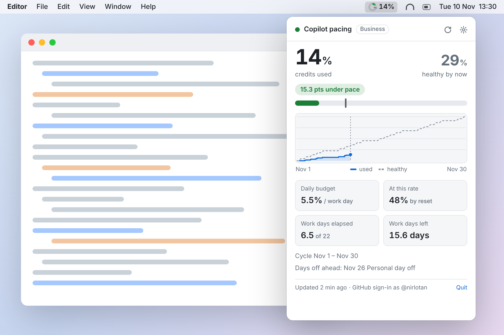
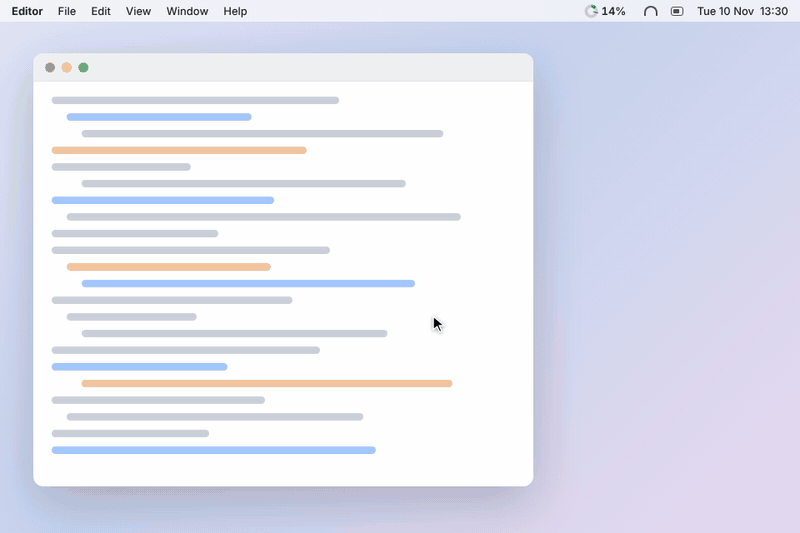
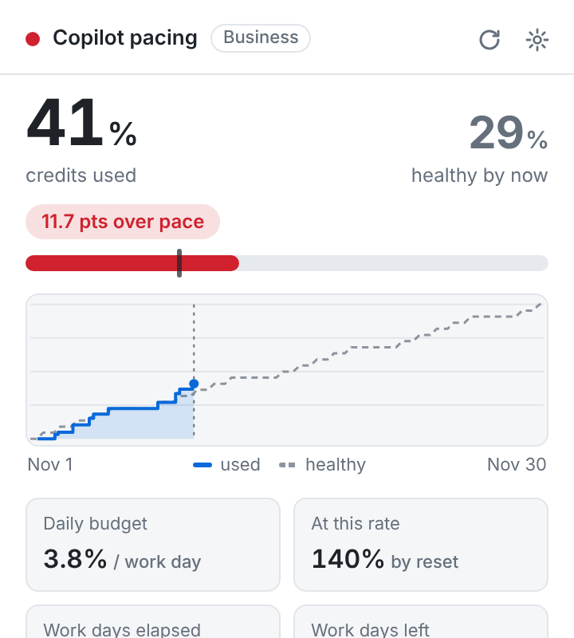
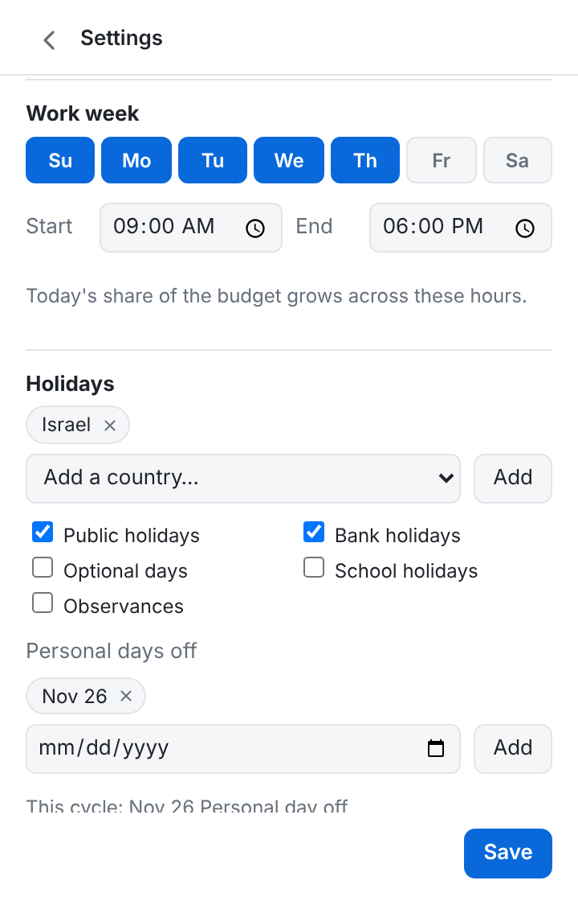
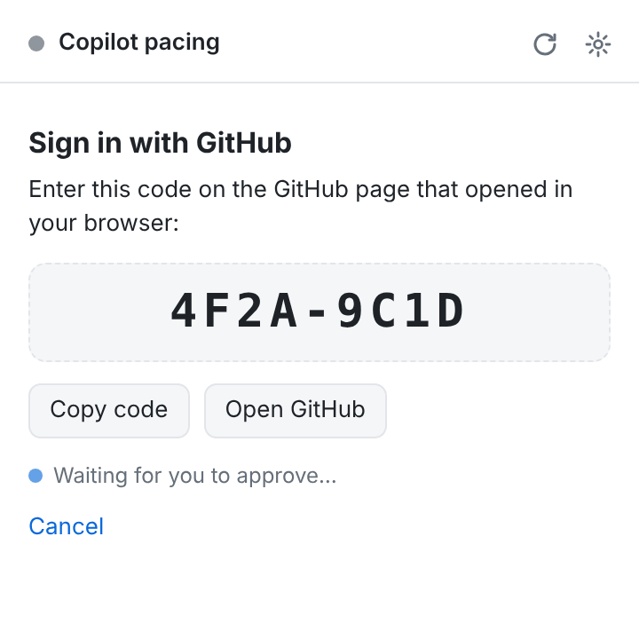
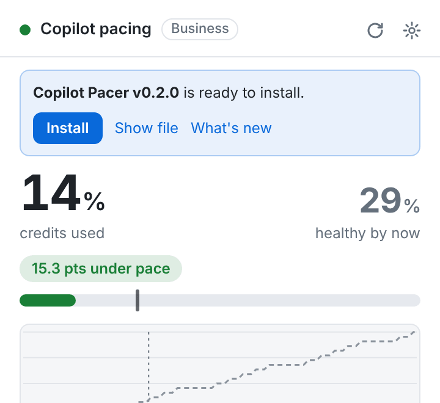
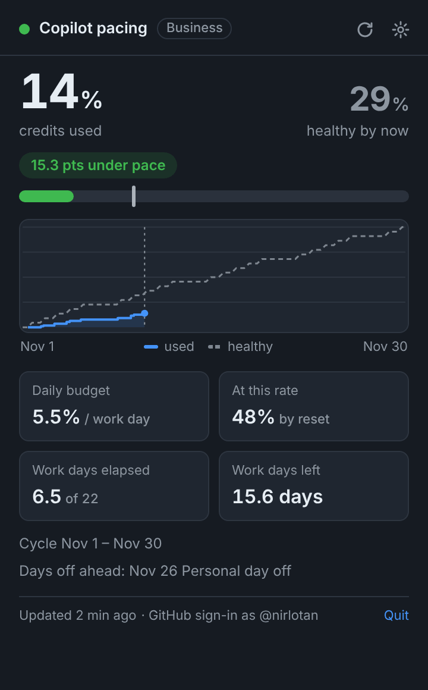

<p align="center">
  
</p>

<h1 align="center">Copilot Pacer</h1>

<p align="center">
  <b>Will your GitHub Copilot credits last the month? Know at a glance.</b><br>
  A tiny menu-bar (macOS) and system-tray (Windows) app that compares the Copilot
  credits you've used with what's <i>healthy</i> by now, counting only your working days.
</p>

<p align="center">
  <a href="https://github.com/nirlotan/copilot-pacer/releases/latest/download/Copilot-Pacer-macOS.dmg"></a>
  &nbsp;
  <a href="https://github.com/nirlotan/copilot-pacer/releases/latest/download/Copilot-Pacer-Windows-Setup.exe"></a>
</p>

<p align="center">
  <a href="https://github.com/nirlotan/copilot-pacer/releases/latest"></a>
  <a href="https://github.com/nirlotan/copilot-pacer/actions/workflows/build.yml"></a>
  
  
</p>

<p align="center">
  <picture>
    <source media="(prefers-color-scheme: dark)" srcset="docs/hero-dark.png">
    
  </picture>
</p>

<p align="center">
  <a href="#why">Why</a> ·
  <a href="#see-it-in-action">Demo</a> ·
  <a href="#features">Features</a> ·
  <a href="#download--install">Install</a> ·
  <a href="#getting-started">Getting started</a> ·
  <a href="#how-the-healthy-line-works">How it works</a> ·
  <a href="#faq">FAQ</a>
</p>

---

## Why

The Copilot extension tells you that you've used **14%** of your credits.
It doesn't tell you whether that's a lot.

On the 9th of the month it's fine. On the 27th, after a week off, it's a
different story. Copilot Pacer works out a **healthy usage line** for your
billing cycle that skips weekends, public holidays and your days off. It then
shows, right in your menu bar, whether you're ahead of that line or behind it.

- **Don't run dry** a week before the reset.
- **Don't leave credits unused** because you were saving them "just in case".
- **Know your daily budget:** how much you can use per working day from here on.

## See it in action

<p align="center">
  
</p>

## Features

<table>
  <tr>
    <td width="50%" valign="top">
      <h3>🎯 One glance in the menu bar</h3>
      A ring fills with your usage and turns <b>green</b>, <b>amber</b> or <b>red</b>
      depending on your pace. A small tick marks where you should be today.
      On macOS your % sits right next to it.
      <br><br>
      
    </td>
    <td width="50%" valign="top">
      <h3>🚦 Know when you're over pace</h3>
      See exactly how far ahead or behind you are, a <b>daily budget</b> for the
      rest of the cycle, and a <b>forecast</b> of where you'll land at your
      current rate. You also get a notification, at most once a day.
      <br><br>
      
    </td>
  </tr>
  <tr>
    <td width="50%" valign="top">
      <h3>📅 Your calendar, not the calendar</h3>
      Pick your work week (Mon–Fri, Sun–Thu, anything) and working hours.
      Add <b>public holidays for 200+ countries and regions</b> (built in, works
      offline) plus your own days off. Today counts in proportion to how much
      of your working hours has passed.
      <br><br>
      
    </td>
    <td width="50%" valign="top">
      <h3>🔐 One-click GitHub sign-in</h3>
      Sign in with GitHub's device flow, or let Copilot Pacer pick up your
      existing <code>gh</code> CLI login. Your token stays in the macOS Keychain
      or Windows Credential Manager.
      <br><br>
      
    </td>
  </tr>
  <tr>
    <td width="50%" valign="top">
      <h3>⬆️ Keeps itself up to date</h3>
      Checks GitHub for new releases daily (or on demand from the tray menu),
      downloads the installer for you and offers a one-click <b>Install</b>.
      <br><br>
      
    </td>
    <td width="50%" valign="top">
      <h3>🌗 Feels native</h3>
      Light and dark mode, launch at login, optional Dock or taskbar icon, and
      it shows over full-screen apps. It's a native app, not Electron: a 5 MB
      download on macOS and 2 MB on Windows.
      <br><br>
      
    </td>
  </tr>
</table>

**Also included:**
- **Any billing cycle:** credits reset on the 1st by default; pick another day if yours differs.
- **Works behind corporate proxies:** detected automatically, including PAC/WPAD files.
- **Private by design:** it talks only to GitHub, with no analytics and no telemetry.

## Download & install

| Platform | Download | Notes |
| --- | --- | --- |
| **macOS** 10.15+ (Apple Silicon & Intel) | [**Copilot-Pacer-macOS.dmg**](https://github.com/nirlotan/copilot-pacer/releases/latest/download/Copilot-Pacer-macOS.dmg) | Universal app |
| **Windows** 10/11 (x64) | [**Copilot-Pacer-Windows-Setup.exe**](https://github.com/nirlotan/copilot-pacer/releases/latest/download/Copilot-Pacer-Windows-Setup.exe) | Recommended installer |
| Windows (MSI, for managed deployment) | [Copilot-Pacer-Windows.msi](https://github.com/nirlotan/copilot-pacer/releases/latest/download/Copilot-Pacer-Windows.msi) | |

Older versions and release notes are on the [Releases page](https://github.com/nirlotan/copilot-pacer/releases).

<details>
<summary><b>macOS</b> installation</summary>

1. Open `Copilot-Pacer-macOS.dmg` and drag **Copilot Pacer** into **Applications**.
2. Launch it. A ring appears in the menu bar (no Dock icon unless you turn it on).
3. If macOS says the app "can't be opened" or "is damaged" (builds that
   aren't notarized), run this once in Terminal:
   ```sh
   xattr -cr "/Applications/Copilot Pacer.app"
   ```
   Or right-click the app → **Open** → **Open**.

</details>

<details>
<summary><b>Windows</b> installation</summary>

1. Run `Copilot-Pacer-Windows-Setup.exe`.
2. If SmartScreen shows "Windows protected your PC", click **More info →
   Run anyway**.
3. The ring appears in the system tray. If it's hidden, click the **^** arrow
   and drag the icon onto the taskbar to keep it visible.

</details>

## Getting started

1. **Click the ring in your menu bar / tray** and choose **Sign in with GitHub**.
   Your browser opens GitHub's device page and the code is already copied.
   Paste it and approve.
   > [!TIP]
   > GitHub signs in **whichever account your browser is logged into**.
   > Check the "Signed in as …" line on that page. If it's the wrong account,
   > sign out on github.com first or open the link in a private window.

   Already use the [GitHub CLI](https://cli.github.com)? If you're logged in
   with `gh`, Copilot Pacer picks that up automatically and you can skip this.
2. **Open Settings (⚙)** and set your work week, working hours, holiday
   countries and any days off. Israeli time zones start with a Sun–Thu week
   and Israeli holidays; everyone else starts with Mon–Fri.
3. **Say yes to "Launch at login"** when asked, so it's always there.

That's it. Usage refreshes every 10 minutes (configurable), and the healthy
line moves every minute.

## How the healthy line works

Each working day in your cycle gets an equal slice of 100%. Weekends,
holidays and days off get nothing, so the line stays flat across them.
Today's slice fills up gradually during your working hours.

```text
healthy %    = working days elapsed (incl. part of today) ÷ working days in cycle × 100
daily budget = (100 − used %) ÷ working days left
```

| Colour | Meaning |
| --- | --- |
| 🟢 Green | At or below the healthy line |
| 🟠 Amber | Above it, but within your tolerance (default 5 points) |
| 🔴 Red | Above it by more than your tolerance (you'll get a notification) |

## Corporate networks & proxies

Behind a company proxy? By default (**Settings → Network → Automatic**),
Copilot Pacer finds your proxy the way your OS does, including PAC/WPAD
auto-config files on both macOS and Windows. It also falls back to the
`HTTPS_PROXY` set in your shell. **Settings → Network** shows which proxy it's
using and where that came from. You can also enter one manually
(`http://`, `https://` or `socks5://`) or turn the proxy off.

If your organisation uses SAML single sign-on, GitHub may ask you to
authorise the sign-in for your organisation.

## Privacy

- Copilot Pacer talks **only to GitHub**: the same usage endpoint the
  Copilot editor extensions use, GitHub sign-in, and GitHub Releases for
  update checks.
- Your token stays in the **macOS Keychain / Windows Credential Manager**.
- Settings and a small usage history stay on your computer. No analytics,
  no telemetry, no servers of ours.

## FAQ

<details>
<summary><b>It's showing the wrong GitHub account.</b></summary>

Copilot Pacer prefers an account added with *Sign in with GitHub*. Otherwise
it uses the active GitHub CLI account. Go to Settings → Account → **Sign in
with GitHub instead** and approve the sign-in in a browser logged into the
right account. Or run `gh auth switch -u <user>` and restart the app.

</details>

<details>
<summary><b>My company's reset date isn't the 1st.</b></summary>

Change *Settings → Billing cycle → Credits reset on day*. If it differs from
the date GitHub reports, the popup shows GitHub's date next to the cycle.

</details>

<details>
<summary><b>I see "Could not reach GitHub".</b></summary>

You're probably behind a proxy. Open **Settings → Network** and click
**Detect again**, or enter your proxy manually.

</details>

<details>
<summary><b>Does it work with Copilot Individual, Business and Enterprise?</b></summary>

It reads the same credit meter the Copilot extension shows in your editor, so
it works with whichever plan your account has. Plans with unlimited credits
show ∞ instead of a pace.

</details>

<details>
<summary><b>Will it keep working if GitHub changes things?</b></summary>

The usage figure comes from the same (undocumented) endpoint that powers the
Copilot meter in VS Code. If GitHub changes it, the popup shows an error, and
an update will follow. The app updates itself.

</details>

## Contributing

Bug reports and ideas are welcome. [Open an issue](https://github.com/nirlotan/copilot-pacer/issues).
Pull requests are welcome too; the developer notes below get you running in a
couple of minutes.

<details>
<summary><b>For developers</b>: build, test, release</summary>

Built with [Tauri 2](https://v2.tauri.app) (Rust) and a small vanilla
TypeScript UI.

```sh
npm install
npm run tauri dev       # run locally with hot reload
npm test                # TypeScript tests
npm run test:rust       # Rust tests (pacing math, icon, parsing, proxy, versions)
npm run tauri build     # installers for the current OS
```

Prerequisites: Node 20+, Rust stable, and the
[Tauri prerequisites](https://v2.tauri.app/start/prerequisites/) for your OS.

**Releasing:** bump `version` in `package.json`, `src-tauri/tauri.conf.json`
and `src-tauri/Cargo.toml`, then:

```sh
git commit -am "v0.2.0" && git tag v0.2.0 && git push && git push --tags
```

GitHub Actions builds the macOS (universal) and Windows installers and
publishes a release with fixed file names, so the download links above always
point at the newest version. Every push to `main` also builds installers,
which you can download from the run's **Artifacts**.

**Signing the macOS build:** when these repository secrets are set
(**Settings → Secrets and variables → Actions**), CI signs and notarizes the
macOS app. Without them, it builds unsigned.

| Secret | Value |
| --- | --- |
| `APPLE_CERTIFICATE` | Your *Developer ID Application* certificate + key exported as `.p12`, base64-encoded |
| `APPLE_CERTIFICATE_PASSWORD` | The `.p12` export password |
| `APPLE_SIGNING_IDENTITY` | e.g. `Developer ID Application: Your Name (TEAMID)` |
| `APPLE_API_ISSUER`, `APPLE_API_KEY`, `APPLE_API_KEY_P8` | App Store Connect API key for notarization: issuer ID, key ID, `.p8` file contents (preferred) |
| `APPLE_ID`, `APPLE_PASSWORD`, `APPLE_TEAM_ID` | Alternative to the API key: Apple ID, app-specific password, team ID |

**Project layout**

| Path | What |
| --- | --- |
| `src-tauri/src/pace.rs` | Billing cycle, working-day pacing, pace curve |
| `src-tauri/src/icon.rs` | Tray gauge renderer |
| `src-tauri/src/api.rs` | Copilot usage client |
| `src-tauri/src/auth.rs` | Keychain, `gh` token lookup, GitHub device sign-in |
| `src-tauri/src/proxy.rs`, `proxy_util.rs`, `pac_eval.js` | Automatic proxy detection (env, macOS PAC via JXA, Windows resolver, login shell) |
| `src-tauri/src/store.rs` | Settings and usage history |
| `src-tauri/src/update.rs`, `version.rs` | Update check against GitHub Releases, installer download |
| `src-tauri/src/lib.rs` | Tray, popup window, polling, commands, notifications |
| `src/` | Popup UI and holiday calendars (`date-holidays`) |

</details>

## Acknowledgements

Built with [Tauri](https://tauri.app) and [date-holidays](https://github.com/commenthol/date-holidays).
Usage data comes from GitHub Copilot.

<sub>Copilot Pacer is an independent project and is not affiliated with or endorsed by GitHub.
Screenshots show sample data.</sub>
